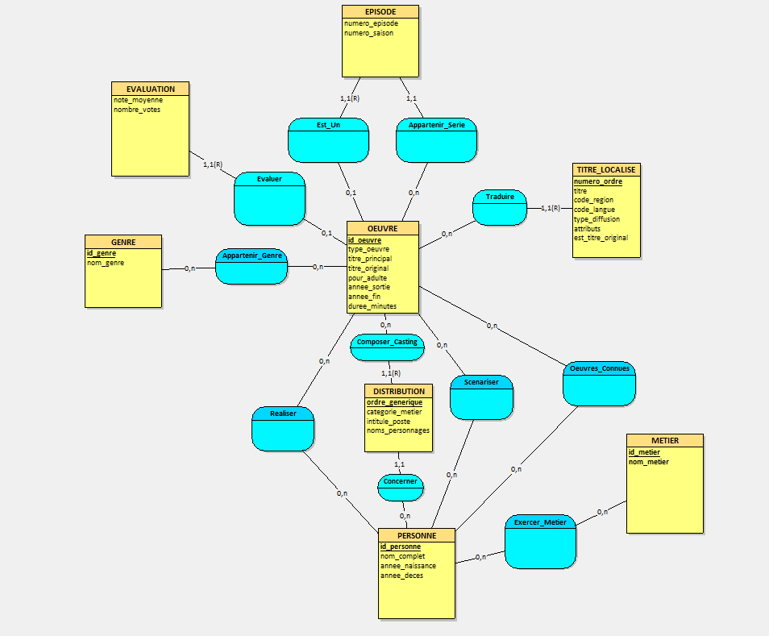

# Livrable 5 : Analyse de la base de données fournie

## 1 - Présentation des données.

Lien des données : https://data.imdb.com/non-commercial-datasets/  

Pour l’analyse de la base de la base données nous nous sommes basés sur le sujet de la SAE, c'est-à- dire ces spécifications, contraintes etc. Et également nous avons analysé les fichiers de données fournies par IMDb.

Donc tout d’abord nous avons analysé et énuméré chaque élément important pour notre application, c'est-à -dire qu’elle se basera sur des œuvres tels que des films, des séries mais aussi sur des personnages,des acteurs, des réalisateurs etc.

Pour mieux structurer notre base de données nous avons donc pensé a des tables qui pourront donc stocker et accueillir chacune de ces informations essentiels aux fonctionnement de notre application.

La première qui nous paraissait évidente est la table “oeuvres” qui regroupe donc toutes les œuvres présentes sur notre application comme les films, les séries, courts-métrages etc. Elle regroupe des informations comme son “id’, quel type d’oeuvre elle correspond, son titre principal celui qui est utilisé à l'international et original mais qui est facultatif, ensuite il y a l’attribut “pour_adulte” qui est un booléen qui permet de dire si une oeuvre à un âge recommandée, il y a aussi son année de sortie, et pour les series,mini-series sont années de fin et sa durée en minutes. Elle regrouperait donc les informations essentielles d’une œuvre. Elle se base sur le fichier “title.basics.tsv.gz”.

Pour la prochaine table, les spécifications demandent qu’on puisse associer des personnes à chaque œuvre, donc nous avons créé une table “personnes” qui répertorie les acteurs, réalisateurs, scénaristes et producteurs. Cette table contient des attributs plutôt basiques comme le nom de la personne, son année de naissance et de décès. Cette table nous permettra donc d’associer une personne à une ou plusieurs œuvres. Elle se base sur le fichier “name.basics.tsv.gz”. 

Nous avons remarqué que dans les données fournies par IMDb, un fichier contenait la moyenne des notes des différents films avec des colonnes “AverageRating” et “numVotes”. Nous avons donc eu l’idée de l'intégrer à notre application avec une table qui se nomme Evaluations et qui contient comme clé primaire l'attribut “id_oeuvre” qui fait référence à la table Oeuvre. La table Evaluation contient également les attributs  “note_moyenne” et “nombre_votes” qui contiennent les informations contenues dans les colonnes “AverageRating” et “numVotes” dans le fichier “title.ratings.tsv.gz”. 

Les données disponibles sur IMDb contiennent également un fichier se nommant “title.akas.tsv.gz”, ce fichier contient de nombreuses informations très utiles sur les différentes œuvres. Le fichier contient notamment “title”, “region” et “language” qui permettent d’avoir un titre par pays, par exemple, et de savoir en quelle langue est ce titre, ce qui permet d’avoir un titre traduit au Canada en français, mais le titre original qui est en anglais en France, par exemple. Le fichier contient aussi “isOriginalTitle”. Cette donnée nous permet de savoir si le titre est l'original à un endroit donné ou s'il a été modifié. Pour la table Titres_localisés, nous utiliserons une clé primaire composée qui utilisera “id_oeuvre”, qui fait référence à la table Oeuvre et “ordre” qui contient un numéro, ce qui nous permettra de ne pas avoir de redondance. La table Titres_Localises contiendra donc les attributs “id_oeuvre”, “ordre”, “titre”, “code_region”, “code_langue”, “type_diffusion”, “attributs_supplementaires” et  “est_titre_original”.

Pour les séries, il nous fallait une table qui nous permettrait donc d’associer à une série chaque épisode pour que l'utilisateur puisse avoir par épisode des informations précises. Donc dans notre table “episodes” elle possède des attributs comme “id_episode” qui est sa clé primaire, ensuite un “id_serie_parente” qui est une clé étrangère qui fait référence à l’oeuvre à laquelle l'épisode est associé, ensuite “numero_saison” qui correspond à la combientième saison est présent l’épisode et également son numéro d'épisode avec “numero_episode”. Elle se base sur le fichier “title.episode.tsv.gz”.

Nous allons avoir également besoin des informations dans le fichier “title.principals.tsv.gz” avec “nconst” qui nous permet de savoir le nom et prénom des personnes, “category” qui permet de savoir le travaille de la personne, “job” qui nous permet de savoir le poste de la personne et “character” qui nous permet de savoir le nom du personnage qu’il jouer. Ces données seront utilisées dans la table Distribution.

 

## 2 - Identification des principales entités.  

Nous avons donc identifié comme principales entités : 

<ins>Oeuvres :</ins> Avec un identifiant, un type, un titre principal, un titre original, un indicateur pour adulte, une année de sortie, une année de fin et une durée en minutes 

<ins>Personnes :</ins> avec un identifiant, un nom complet, une année de naissance et une année de décès.

<ins>Evalutations :</ins> avec un identifiant d’une œuvre, une note moyenne, et un nombre de votes.

<ins>Titres_Localises :</ins> avec un identifiant d’une œuvre, un ordre, un titre, le code de la région, un code langue, un type de diffusion, des attributs supplémentaires et une indication de s’il s’agit du titre original.

<ins>Episodes :</ins> Avec un identifiant pour les épisodes, un identifiant de série à laquelle l'épisode est associé,  un numéro de saison et un numéro d’épisode.

<ins>Distribution :</ins> Avec un identifiant d'œuvre, un ordre générique, un identifiant pour les personnes, une catégorie de métier, un intitulé pour chaque poste et des noms de personnages. 

<ins>Genre :</ins> Avec un identifiant de genre et un type de genre.

<ins>Métier :</ins> Avec un identifiant de métier et un type de métier.

 

## 3 - Relation entre les tables. 

Un réalisateur peut avoir réalisé aucune ou plusieurs œuvres      
- Personnes(0,n)-> Oeuvre

Une œuvre peut avoir aucun, un ou plusieurs réalisateurs 		      
- Oeuvres(0,n)-> Personnes  

 

Un scénariste  peut en avoir écrit aucune ou plusieurs œuvres 		
- Personnes(0,n)-> Oeuvres

Une œuvre peut avoir aucun ou plusieurs scénaristes 		          
- Oeuvres(0,n)-> Personnes  

 

Un genre peut avoir aucune ou plusieurs oeuvre			              
- Genre(0,n)->Oeuvre

Une oeuvre peut avoir aucun ou plusieur genre			                
- Oeuvre(0,n)->Genre

 

Un métier peut avoir aucune ou plusieur personne			            
- Metier(0,n)->Personne

Une personne peut avoir aucun ou plusieur métier			            
- Personne(0,n)->Métier  

 

Une évaluation n’a qu’une oeuvre					                        
- Evaluation(1,1)->Oeuvre

Une oeuvre peut avoir aucune ou une évaluation			              
- Oeuvre (0,1)->Evaluation  

 

Un titre localisé à une oeuvre						                        
- Titre_localise(1,1)->Oeuvre

Une oeuvre peut avoir aucun ou plusieur titre localisé		        
- Oeuvre(0,n)->Titre_localise  

 

Une oeuvre peut avoir aucune ou plusieur distribution		          
- Oeuvre(0,n)->Distribution

Une distribution n’a qu’une oeuvre					                      
- Distribution(1,1)->Oeuvre  

 

Une distribution n’a qu’une personne					                    
- Distribution(1,1)->Personne

Une personne peut avoir aucune ou plusieur distribution		        
- Personne(0,n)->Distribution  

 

Un épisode est une oeuvre qui appartient à une série qui est une oeuvre	    
- Episode(1,1)-> Oeuvre

Un épisode appartient forcément à une série parente.			                  
- Oeuvre (0,1) -> Episode

Une oeuvre peut ne pas être une série					                              
- Episode(1,1) -> Oeuvre

Une oeuvre peut être la série parente de zéro, un ou plusieurs épisodes	    
- Oeuvre(0,n) -> Episode  

 

## 4 - Clés primaires et clés étrangères.
  
L’entité Oeuvres possède une clé primaire : **id_oeuvre**.  

L’entité Personnes possède une clé primaire : **id_personne**.  

L’entité Evaluations possède une clé primaire qui est clé étrangère : **id_oeuvre** qui fait référence à la table Oeuvres.  

L’entité Titres_Localises possède une clé primaire composé avec une clef étrangère : **id_oeuvre** qui fait référence à la table Oeuvres et ordre.  

L’entité Episodes possède une clé primaire qui est clé étrangère : **id_episode**.   
Et une clé étrangère : **id_serie_parente** qui fait référence à la table Oeuvres.   

L’entité Distribution possède une clé primaire composé avec une clef étrangère : **id_oeuvre** qui fait référence à la table Oeuvres et **ordre_générique**.  
Et une clé étrangère : **id_personne** qui fait référence à la table Personnes   

L’entité Genre possède une clé primaire : **id_genre**.  

L’entité Métier possède une clé primaire : **id_metier**.  

 

## 5 - Schéma relationnel.  

### 1. Entités principales

**Oeuvres** (<ins>id_oeuvre</ins>, type_oeuvre, titre_principal, titre_original, pour_adulte, annee_sortie, annee_fin, duree_minutes)  
**Personnes** (<ins>id_personne</ins>, nom_complet, annee_naissance, annee_deces)  

### 2. Tables dépendantes

**Evaluations** (<ins>#id_oeuvre</ins>, note_moyenne, nombre_votes)  
**Titres_Localises** (<ins>#id_oeuvre, ordre</ins>, titre, code_region, code_langue, type_diffusion, attributs_supplementaires, est_titre_original)  
**Episodes** (<ins>#id_episode</ins>, #id_serie_parente, numero_saison, numero_episode)  
**Distribution** (<ins>#id_oeuvre, ordre_generique</ins>, #id_personne, categorie_metier, intitule_poste, noms_personnages)  
**Genre** (<ins>id_genre</ins>, nom_genre)  
**Metier** (<ins>id_metier</ins>, nom_metier)  

### 3. Tables d'association

**Oeuvre_Genres** (<ins>#id_oeuvre, #id_genre</ins>)  
**Realisateurs** (<ins>#id_oeuvre, #id_personne</ins>)  
**Scenaristes** (<ins>#id_oeuvre, #id_personne</ins>)  
**Personne_Metiers** (<ins>#id_personne, #id_metier</ins>)  
**Oeuvres_Connues** (<ins>#id_personne, #id_oeuvre</ins>)  

 
 

